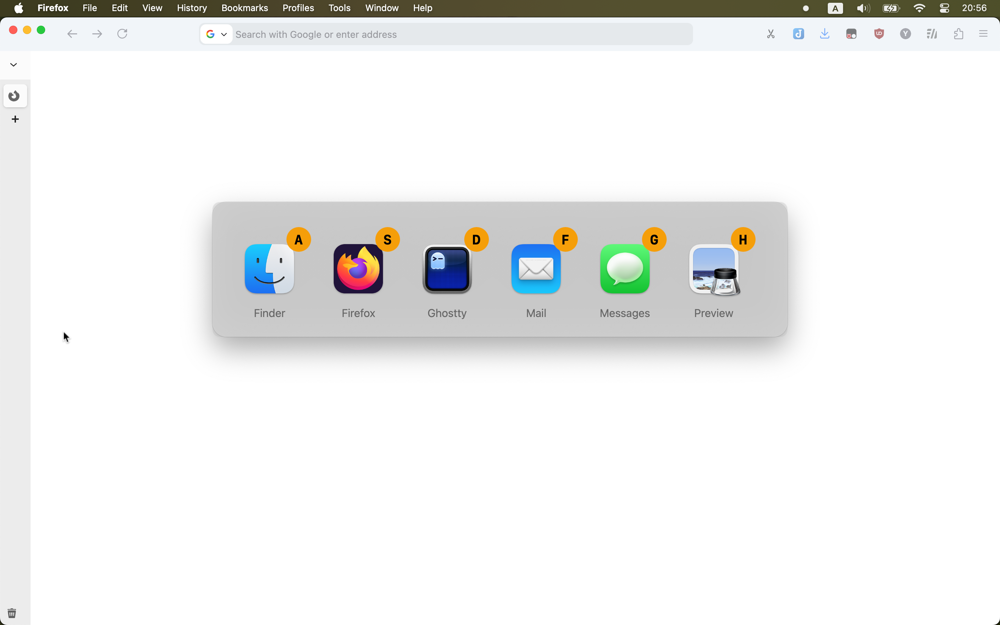

# Yo App Switcher

A keyboard-driven app switcher for macOS. Press a hotkey to bring up a floating translucent panel showing all running Dock apps with Vimium-style hint labels — then press the hint key to switch instantly.

## How It Works

1. Press **Option+a** (customizable) to open the switcher panel
2. Each running app gets a hint key label (A, S, D, F, G, H, J, K, L, etc.)
3. Press the hint key to switch to that app
4. Press **Escape** to dismiss

## Features

- **Floating translucent panel** — compact, centered, stays out of your way
- **Vimium-style hints** — home row keys first for fastest reach
- **Customizable hotkey** — change the shortcut in Preferences
- **Adjustable icon size** — 32pt to 128pt slider in Preferences
- **Launch at Login** — toggle in the menu bar
- **Conflict detection** — warns if shortcut conflicts with system shortcuts
- **Light and dark appearance** — the panel follows the system theme
- **Menu bar only** — no Dock icon, always running, lightweight
- **Universal binary** — works on Apple Silicon and Intel Macs

## Requirements

- macOS 14 (Sonoma) or later
- **Accessibility permission** (prompted on first launch) — required for reliable app switching

## Installation

1. Open the DMG
2. Drag **Yo App Switcher** to the **Applications** folder
3. Launch from Applications
4. Grant Accessibility permission when prompted (System Settings → Privacy & Security → Accessibility)

## Usage

| Action | Default Shortcut |
|--------|-----------------|
| Open switcher panel | Option+a |
| Switch to app | Press the hint key |
| Dismiss panel | Escape |
| Preferences | Menu bar → Preferences... (Cmd+,) |

A recorded shortcut must include a modifier (⌘, ⌥ or ⌃), or be a function key — a bare letter would be captured system-wide and break normal typing.

## Version History

**2.0.2** — App icons wrap onto balanced rows when many apps are open, so the panel never runs past the screen edge  
**2.0.1** — Preferences now shows your Accessibility permission status with a direct link to System Settings, adds the required privacy manifest, and fixes a rare shortcut-recording race  
**2.0** — Clamps the panel to the screen, requires a modifier in recorded shortcuts, correct app activation on macOS 14+, dark mode support, panel closes when it loses focus, layout-aware key names, hotkey/launch-at-login failures are surfaced, expanded test suite  
**1.9** — Updated app icon, adjusted panel background styling  
**1.8** — Reworked app switcher panel with semi-transparent background, cross-version compatibility  
**1.6** — Launch at login reliability fix for older macOS, version display cleanup  
**1.05** — App icon update, xcodegen scheme configuration  
**0.25** — App icon update, version bump  
**0.2** — App Store submission readiness, sandbox entitlement, menu bar icon  
**0.1** — Initial release

## Download Link

https://apps.apple.com/us/app/yoappswitcher/id6778926070?mt=12
