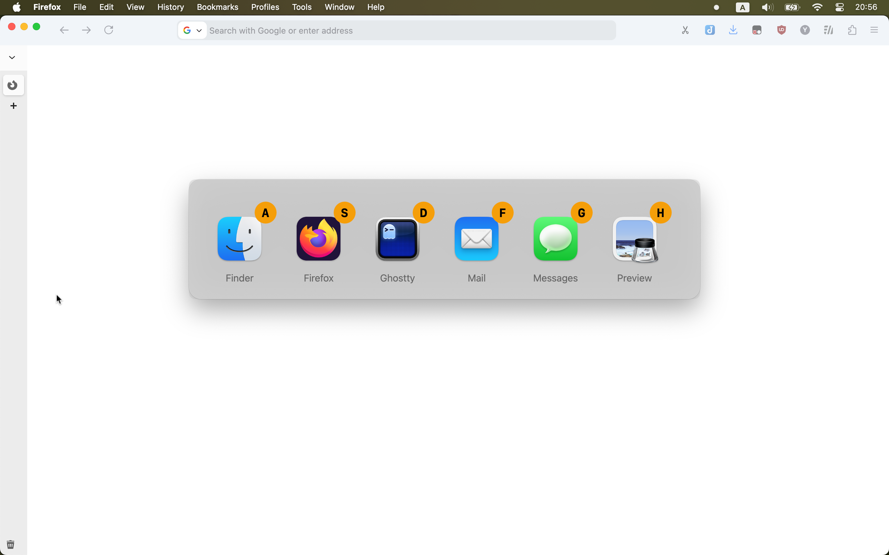

# Yo App Switcher（Yo 应用切换器）

macOS 键盘驱动应用切换器。按下快捷键呼出浮动半透明面板，显示所有正在运行的 Dock 应用图标，并附带 Vimium 风格的提示键标签——按下提示键即可瞬间切换。

## 工作原理

1. 按下 **Option+a**（可自定义）打开切换面板
2. 每个运行中的应用分配一个提示键标签（A、S、D、F、G、H、J、K、L 等）
3. 按下对应提示键切换到该应用
4. 按下 **Escape** 关闭面板

## 功能特性

- **浮动半透明面板** — 紧凑居中，不干扰工作
- **Vimium 风格提示键** — 主行按键优先，最快触达
- **可自定义快捷键** — 在偏好设置中更改
- **可调整图标大小** — 偏好设置中提供 32–128pt 滑块
- **开机自启** — 菜单栏中开启
- **冲突检测** — 快捷键与系统快捷键冲突时发出警告
- **浅色/深色外观** — 面板跟随系统主题
- **仅菜单栏运行** — 无 Dock 图标，始终运行，轻量级
- **通用二进制** — 同时支持 Apple Silicon 和 Intel Mac

## 系统要求

- macOS 14（Sonoma）或更高版本
- **辅助功能权限**（首次启动时提示）— 应用切换所必需

## 安装方法

1. 打开 DMG 文件
2. 将 **Yo App Switcher** 拖入 **Applications（应用程序）** 文件夹
3. 从应用程序文件夹启动
4. 根据提示授予辅助功能权限（系统设置 → 隐私与安全性 → 辅助功能）

## 使用说明

| 操作 | 默认快捷键 |
|------|-----------|
| 打开切换面板 | Option+a |
| 切换到应用 | 按下对应的提示键 |
| 关闭面板 | Escape |
| 偏好设置 | 菜单栏 → Preferences... (Cmd+,) |

录制的快捷键必须包含修饰键（⌘、⌥ 或 ⌃），或使用功能键——单独的字母键会被系统全局捕获，导致正常输入失效。

## 版本历史

**2.0.2** — 应用图标过多时自动换行并均衡分行，面板不再超出屏幕边界  
**2.0.1** — 偏好设置新增辅助功能权限状态与系统设置入口，添加隐私清单，修复罕见的快捷键录制竞态  
**2.0** — 面板尺寸限制在屏幕内，录制快捷键必须带修饰键，修复 macOS 14+ 应用激活，支持深色模式，面板失焦自动关闭，按键名称跟随键盘布局，热键/开机自启失败会提示用户，测试覆盖扩充  
**1.9** — 更新应用图标，调整面板背景样式  
**1.8** — 重新设计切换面板，半透明背景，跨版本兼容  
**1.6** — 修复旧版 macOS 开机自启问题，简化版本号显示  
**1.05** — 应用图标更新，xcodegen scheme 配置  
**0.25** — 应用图标更新，版本号升级  
**0.2** — App Store 提交准备，沙盒权限，菜单栏图标  
**0.1** — 初始版本

## 下载链接

https://apps.apple.com/us/app/yoappswitcher/id6778926070?mt=12
